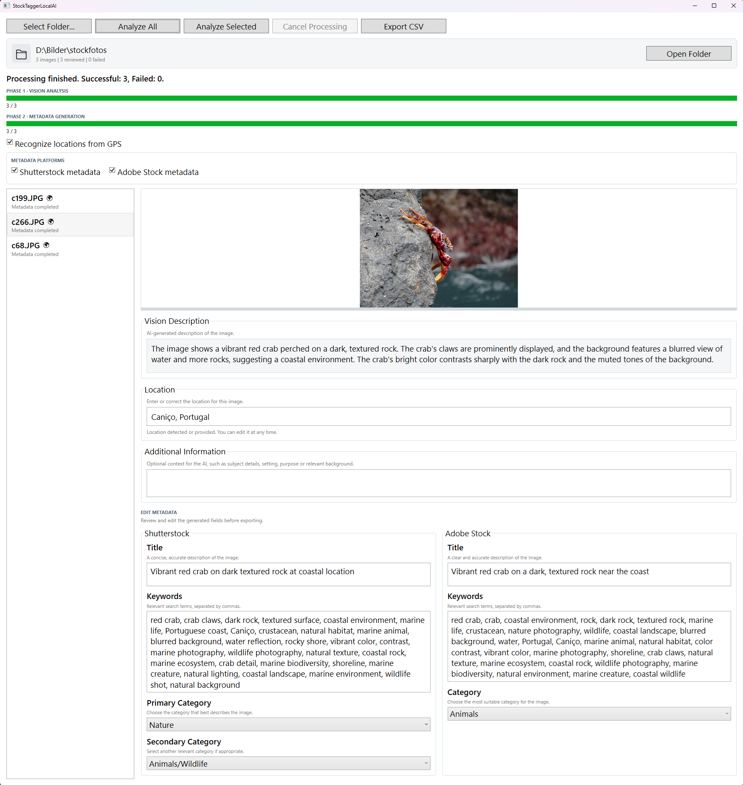

# StockTaggerLocalAI

Local AI-powered image analysis and metadata generation for Shutterstock and Adobe Stock.



## Table of Contents

- [Overview](#overview)
- [How It Works](#how-it-works)
- [Metadata Platforms](#metadata-platforms)
- [Requirements](#requirements)
- [Installation and Setup](#installation-and-setup)
- [Development](#development)
- [Privacy](#privacy)

## Overview

StockTaggerLocalAI is a Windows desktop application that uses locally running AI models to analyze images and generate stock photography metadata.

Built with C# and WPF, the application supports separate metadata workflows for Shutterstock and Adobe Stock. Generated titles, keywords, and categories can be reviewed and edited before being exported to platform-specific CSV files.

## How It Works

StockTaggerLocalAI processes images in two phases.

### Phase 1: Vision Analysis

A local vision model analyzes each image and generates a textual description. GPS coordinates are read from the image's EXIF metadata, if available.

Optionally, StockTaggerLocalAI can use OpenStreetMap Nominatim to resolve GPS coordinates to a location name. Location information and additional user-provided context can help inform metadata generation.

### Phase 2: Metadata Generation

A metadata model uses the image description and optional additional information to generate metadata for the selected platforms.

The generated titles, keywords, and categories can be reviewed and edited in the application before export.

StockTaggerLocalAI provides separate CSV exporters for Shutterstock and Adobe Stock. Either platform can be selected independently, and both can be exported in the same operation.

## Metadata Platforms

### Shutterstock

Generates and manages platform-specific titles, keywords, and primary and secondary categories.

### Adobe Stock

Generates and manages platform-specific titles, keywords, and categories.

Each platform uses its own metadata prompt and CSV exporter.

## Requirements

- Windows 10 or Windows 11
- .NET 9 SDK
- Ollama
- Hardware capable of running the configured AI models

## Installation and Setup

Install the .NET 9 SDK and [Ollama](https://ollama.com/).

### AI Models

StockTaggerLocalAI is currently configured to use the following Ollama models:

- **Vision model:** `qwen2.5vl:7b` — analyzes images and generates textual descriptions.
- **Metadata model:** `qwen3:14b` — generates titles, keywords, and categories for the selected stock photography platforms.

The metadata model is configured to run with thinking disabled to improve the reliability of structured JSON output.

Pull the required models locally:

```powershell
ollama pull qwen2.5vl:7b
ollama pull qwen3:14b
```

### Changing Models

You can potentially use other models supported by Ollama. The vision and metadata models are configured in `OllamaModelSettings.cs`. Update `VisionModel` and `MetadataModel` to the desired Ollama model names and make sure the models are installed locally.

Model compatibility depends on the task:

- **Vision models** must support image input.
- **Metadata models** must reliably generate the structured JSON expected by StockTaggerLocalAI.
- Different models may produce different results in terms of accuracy, keywords, categories, and output formatting.

The current configuration has been set up for the models listed above. Other models may require adjustments to prompts or generation settings.

Switching between different models during processing may take some time, as Ollama may need to load the selected model into memory before processing can continue.

### Run the Application

Ensure Ollama is running and available at:

```text
http://localhost:11434
```

Build the application from the repository root:

```powershell
dotnet build
```

Run the application:

```powershell
dotnet run --project src/StockTaggerLocalAI/StockTaggerLocalAI.csproj
```

## Privacy

- Image analysis and metadata generation use the locally running Ollama service.
- Original image files are not modified by the processing workflow.
- GPS metadata is read locally from image EXIF data.
- If location recognition is enabled, GPS coordinates may be sent to OpenStreetMap Nominatim for reverse geocoding.
- Location recognition requires an internet connection.
- StockTaggerLocalAI generates metadata files but does not automatically upload images or metadata to stock photography platforms.